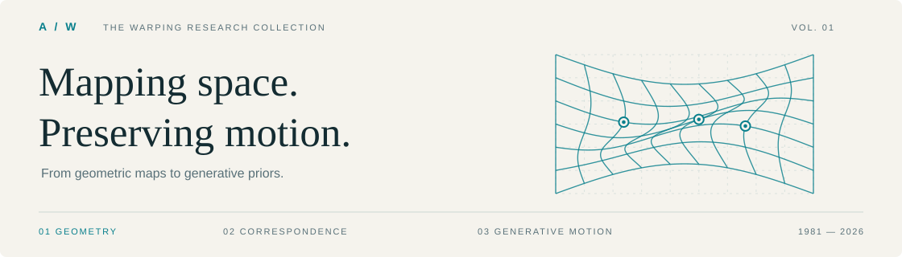

<!-- Generated from data/catalog.json by scripts/build_readme.py. -->

<picture>
  <source media="(prefers-color-scheme: dark)" srcset="assets/warping-banner-dark.svg">
  
</picture>

# Awesome Warping Algorithms

**Geometry · Correspondence · Resampling · Generative Motion**

从经典几何变换到生成式运动控制，按 **基础技术 × 应用领域** 探索 Warping。

   

**[基础技术](#technology)** · **[应用领域](#topics)** · **[2022–2026](#recent)** · **[经典方法](#classics)** · **[研究指南](docs/RESEARCH_GUIDE.zh-CN.md)**

更新于 2026-10-24 · 中文导读 / English paper titles · 持续维护的研究地图

---

## 从这里开始

| 想了解什么？ | 阅读入口 |
| --- | --- |
| **Warping 的基础与实现** | [TPS](#c05) → [MLS](#c08) → [STN](#c13) → [Softmax Splatting](#c19) |
| **运动估计与视频对齐** | [PWC-Net](#c15) → [RAFT](#c20) → [GMFlow](#n01) → [SEA-RAFT](#n13) → [MEMFOF](#n20) |
| **三维形变与动态场景** | [D-NeRF](#c21) → [Nerfies](#c22) → [Deformable 3D Gaussians](#n11) → [4D-GS](#n12) |
| **扩散模型与运动控制** | [∫-noise](#n16) → [Go-with-the-Flow](#n19) → [CameraNoise](#n24) · [GenWarp](#n15) → [SplatDiff](#n23) |

**资源图例**　蓝色 **Paper**：原论文 · 青色 **Project**：作者项目/文档 · 深色 **GitHub**：代码 · **Stars / Forks**：该代码仓库的动态计数。

灰色「未核实」表示尚无已核验的对应入口，不表示资源一定不存在。复现代码与通用实现框架会单独标注；框架计数属于整个仓库。Stars / Forks 由 Shields.io 提供并有缓存，不作为论文质量排名。

<b>收录范围与年份口径</b>

以计算机视觉、图形学和医学图像中的**空间 warping** 为主。区分变换模型、对应估计、采样算子及其应用系统；DTW 时间序列对齐和 GPU warp 不在本目录内。

“经典”指截至 2021 年的工作；2022–2026 按代表性正式发表年份整理，并保留早期预印本说明。2026 年覆盖截至 2026-10-24 的公开资料。方法贡献和局限来自原论文、作者资料与原版调研；本合集未对所有实现做统一复现。

[完整定义、Forward / Backward 与核验原则 →](docs/RESEARCH_GUIDE.zh-CN.md#scope)

## 基础技术 · Technology map

一种方法可以跨多个技术族；点击方法名直达条目，条目的 `T1–T9` 标签可返回本表。

<b>展开 9 类基础技术与文献索引</b>

| 技术族 | 核心表示 | 文献入口 |
| --- | --- | --- |
| **T1 · 参数化几何变换** | 刚体 / 相似 / 仿射 / 单应性 | [Rigid / Similarity / Affine / Homography](#c01) · [Lucas–Kanade / Inverse Compositional](#c02) · [UDIS++: Parallax-Tolerant Unsupervised Deep Image Stitching](#n08) |
| **T2 · 控制点、样条与连续插值** | TPS / RBF / FFD / B-spline / MLS | [Free-Form Deformation (FFD)](#c04) · [Thin-Plate Spline (TPS) / Principal Warps](#c05) · [Beier–Neely Feature-Based Morphing](#c06) · [B-spline FFD Registration](#c07) · [Moving Least Squares (MLS)](#c08) · [CP-VTON](#c24) · [Thin-Plate Spline Motion Model for Image Animation](#n03) · [UDIS++: Parallax-Tolerant Unsupervised Deep Image Stitching](#n08) · [StabStitch](#n28) · [WarpI2I](#n26) |
| **T3 · 网格与局部形状保持** | 分片变换 / ARAP / 局部投影 | [As-Rigid-As-Possible (ARAP) Surface Modeling](#c09) · [Content-Preserving Warps for 3D Video Stabilization](#c29) · [As-Projective-As-Possible (APAP) / Moving DLT](#c12) · [UDIS++: Parallax-Tolerant Unsupervised Deep Image Stitching](#n08) · [StabStitch](#n28) |
| **T4 · 稠密对应与光流** | 稠密 flow / 相关体 / 全局匹配 | [Lucas–Kanade / Inverse Compositional](#c02) · [Horn–Schunck](#c03) · [Brox et al. Variational Optical Flow](#c27) · [PWC-Net](#c15) · [RAFT](#c20) · [GMFlow](#n01) · [FlowFormer](#n02) · [FILM: Frame Interpolation for Large Motion](#n04) · [BasicVSR++](#n07) · [UniMatch: Unifying Flow, Stereo and Depth Estimation](#n09) · [SEA-RAFT](#n13) · [MEMFOF](#n20) |
| **T5 · 可逆形变与医学配准** | 速度场 / 微分同胚 / 逆一致性 | [B-spline FFD Registration](#c07) · [LDDMM / Geodesic Flows of Diffeomorphisms](#c26) · [SyN: Symmetric Diffeomorphic Registration](#c10) · [Diffeomorphic Demons](#c11) · [VoxelMorph](#c18) · [TransMorph](#n05) · [SynthMorph](#n06) · [uniGradICON](#n14) |
| **T6 · 深度与三维重投影** | 深度 / 相机位姿 / 投影与可见性 | [Depth-Image-Based Rendering (DIBR)](#c28) · [Monodepth2](#c16) · [UniMatch: Unifying Flow, Stereo and Depth Estimation](#n09) · [GenWarp](#n15) · [WAVE: Warp-Based View Guidance](#n22) · [SplatDiff: High-Fidelity Novel View Synthesis via Splatting-Guided Diffusion](#n23) · [CameraNoise](#n24) · [Warp-as-History](#n27) |
| **T7 · 可微采样与 Splatting** | 插值 / 核足迹 / 冲突聚合 / 伴随 | [EWA Volume Splatting](#c25) · [Spatial Transformer Networks (STN)](#c13) · [Softmax Splatting](#c19) · [ImWIP](#n10) · [How I Warped Your Noise / ∫-noise](#n16) · [LookingGlass / Laplacian Pyramid Warping (LPW)](#n21) · [SplatDiff: High-Fidelity Novel View Synthesis via Splatting-Guided Diffusion](#n23) |
| **T8 · 学习式特征与三维形变** | Offset / 局部仿射 / Canonical field | [Deformable ConvNets (DCN)](#c14) · [First Order Motion Model (FOMM)](#c17) · [D-NeRF](#c21) · [Nerfies](#c22) · [HyperNeRF](#c23) · [Thin-Plate Spline Motion Model for Image Animation](#n03) · [FILM: Frame Interpolation for Large Motion](#n04) · [BasicVSR++](#n07) · [Deformable 3D Gaussians](#n11) · [4D Gaussian Splatting for Real-Time Dynamic Scene Rendering](#n12) |
| **T9 · 生成式、频率与随机场** | 几何生成融合 / Noise transport / 频率处理 | [CP-VTON](#c24) · [First Order Motion Model (FOMM)](#c17) · [GenWarp](#n15) · [How I Warped Your Noise / ∫-noise](#n16) · [Warped Diffusion](#n17) · [StableVITON](#n18) · [Go-with-the-Flow](#n19) · [LookingGlass / Laplacian Pyramid Warping (LPW)](#n21) · [WAVE: Warp-Based View Guidance](#n22) · [SplatDiff: High-Fidelity Novel View Synthesis via Splatting-Guided Diffusion](#n23) · [CameraNoise](#n24) · [DMAligner](#n25) · [WarpI2I](#n26) · [Warp-as-History](#n27) |

## 应用领域 · Topic index

<b>展开 16 个应用领域与文献索引</b>

| Topic / 领域 | 关注的问题 | 文献入口 |
| --- | --- | --- |
| **图像配准** Registration | 两幅图的空间对齐 | [Rigid / Similarity / Affine / Homography](#c01) · [Lucas–Kanade / Inverse Compositional](#c02) · [Thin-Plate Spline (TPS) / Principal Warps](#c05) · [B-spline FFD Registration](#c07) · [UDIS++: Parallax-Tolerant Unsupervised Deep Image Stitching](#n08) · [DMAligner](#n25) |
| **医学图像** Medical imaging | 三维器官、跨模态与跨个体配准 | [LDDMM / Geodesic Flows of Diffeomorphisms](#c26) · [SyN: Symmetric Diffeomorphic Registration](#c10) · [Diffeomorphic Demons](#c11) · [VoxelMorph](#c18) · [TransMorph](#n05) · [SynthMorph](#n06) · [uniGradICON](#n14) |
| **拼接与全景** Stitching | 对齐重叠区，同时控制非重叠区畸变 | [Rigid / Similarity / Affine / Homography](#c01) · [As-Projective-As-Possible (APAP) / Moving DLT](#c12) · [UDIS++: Parallax-Tolerant Unsupervised Deep Image Stitching](#n08) |
| **视频稳像与在线拼接** Stabilization | 抑制相机抖动和逐帧 warp 的时间不一致 | [Content-Preserving Warps for 3D Video Stabilization](#c29) · [StabStitch](#n28) |
| **光流与稠密对应** Optical flow | 寻找跨帧像素对应，生成可供 warp 使用的 flow | [Lucas–Kanade / Inverse Compositional](#c02) · [Horn–Schunck](#c03) · [Brox et al. Variational Optical Flow](#c27) · [PWC-Net](#c15) · [RAFT](#c20) · [GMFlow](#n01) · [FlowFormer](#n02) · [UniMatch: Unifying Flow, Stereo and Depth Estimation](#n09) · [SEA-RAFT](#n13) · [MEMFOF](#n20) |
| **视频插帧** Frame interpolation | 构造中间时刻，对冲突和反遮挡进行处理 | [Softmax Splatting](#c19) · [FILM: Frame Interpolation for Large Motion](#n04) |
| **视频复原** Video restoration | 对齐并融合跨帧信息 | [Deformable ConvNets (DCN)](#c14) · [PWC-Net](#c15) · [RAFT](#c20) · [BasicVSR++](#n07) · [Warped Diffusion](#n17) |
| **图像编辑与形状操控** Image editing | 由点、线或网格控制局部形变 | [Free-Form Deformation (FFD)](#c04) · [Thin-Plate Spline (TPS) / Principal Warps](#c05) · [Beier–Neely Feature-Based Morphing](#c06) · [Moving Least Squares (MLS)](#c08) · [As-Rigid-As-Possible (ARAP) Surface Modeling](#c09) · [LookingGlass / Laplacian Pyramid Warping (LPW)](#n21) · [WarpI2I](#n26) |
| **人物动画与运动迁移** Animation | 从 driving motion 驱动 source appearance | [First Order Motion Model (FOMM)](#c17) · [Thin-Plate Spline Motion Model for Image Animation](#n03) · [Go-with-the-Flow](#n19) |
| **虚拟试衣** Virtual try-on | 服装到人体的对齐，保持纹理与标识 | [CP-VTON](#c24) · [StableVITON](#n18) |
| **深度与多视图几何** Multi-view geometry | 由几何约束建立跨视图对应 | [Rigid / Similarity / Affine / Homography](#c01) · [Monodepth2](#c16) · [UniMatch: Unifying Flow, Stereo and Depth Estimation](#n09) |
| **新视角合成** Novel view synthesis | 相机改变后的几何投影与内容补全 | [Depth-Image-Based Rendering (DIBR)](#c28) · [Monodepth2](#c16) · [D-NeRF](#c21) · [Nerfies](#c22) · [GenWarp](#n15) · [WAVE: Warp-Based View Guidance](#n22) · [SplatDiff: High-Fidelity Novel View Synthesis via Splatting-Guided Diffusion](#n23) |
| **动态三维与4D重建** Dynamic 3D / 4D | 将时间变化映射到 canonical representation | [D-NeRF](#c21) · [Nerfies](#c22) · [HyperNeRF](#c23) · [Deformable 3D Gaussians](#n11) · [4D Gaussian Splatting for Real-Time Dynamic Scene Rendering](#n12) |
| **视频扩散与运动控制** Video diffusion | 将运动或几何约束传递给生成模型 | [Softmax Splatting](#c19) · [RAFT](#c20) · [How I Warped Your Noise / ∫-noise](#n16) · [Go-with-the-Flow](#n19) · [CameraNoise](#n24) · [Warp-as-History](#n27) |
| **计算成像与逆问题** Inverse problems | 把 motion warp 纳入测量算子与梯度计算 | [B-spline FFD Registration](#c07) · [Spatial Transformer Networks (STN)](#c13) · [ImWIP](#n10) · [Warped Diffusion](#n17) |
| **投影艺术与视觉幻象** Anamorphosis | 通过镜面、透镜或视角变换产生不同解释 | [Beier–Neely Feature-Based Morphing](#c06) · [EWA Volume Splatting](#c25) · [LookingGlass / Laplacian Pyramid Warping (LPW)](#n21) |

## 2022–2026 · Recent developments

**[2026](#year-2026)** · **[2025](#year-2025)** · **[2024](#year-2024)** · **[2023](#year-2023)** · **[2022](#year-2022)**

由近及远浏览。每条保留原始来源、技术标签和一句贡献；详细边界与选型见 [研究指南](docs/RESEARCH_GUIDE.zh-CN.md#recent)。

### 2026 · 4 works

#### CameraNoise

****ICML 2026，PMLR 正式论文**** · [`T6`](#t6) [`T9`](#t9)

    

以 Geometry-guided Reprojection Flow 与噪声 warping 将相机运动编码到时序相关噪声中，同时关注 Gaussian 先验与轨迹控制。

作者实现 · <a href="https://github.com/gulucaptain/CameraNoise">gulucaptain/CameraNoise</a>

方法边界与备注

效果依赖场景几何和运动估计；不能据此推导任意非刚性运动均可精确控制

#### DMAligner

**2026；arXiv v2 注明 **CVPR 2026 接收**** · [`T9`](#t9)

    

将图像对齐转为 diffusion-based view synthesis，以动态感知训练处理遮挡与光照变化。

作者实现 · <a href="https://github.com/boomluo02/DMAligner">boomluo02/DMAligner</a>

方法边界与备注

是对传统 flow warp 局限的生成式替代路线；合成对齐不等同于恢复真实逐像素对应

#### WarpI2I

**2026；arXiv 注明 **ECCV 2026**** · [`T2`](#t2) [`T9`](#t9)

    

在编码前用 saliency-guided warp 向显著区域分配更多空间表示，处理后 unwarp，改善紧凑 latent 模型的结构保留。

作者实现 · <a href="https://github.com/ShenZheng2000/WarpI2I">ShenZheng2000/WarpI2I</a>

方法边界与备注

用 warp 分配表示预算，不以运动估计为核心；逆映射受数值采样影响

#### Warp-as-History

****2026 预印本**** · [`T6`](#t6) [`T9`](#t9)

    

将相机诱导的 warp 作为对齐目标位置的伪历史，结合有效 token 选择利用冻结模型的历史输入通路；另探索单视频 LoRA。

作者实现 · <a href="https://github.com/yyfz/Warp-as-History">yyfz/Warp-as-History</a>

方法边界与备注

截止本版仅按公开预印本收录；控制能力仍需跨数据与轨迹验证

[↑ 返回年份导航](#recent)

---

### 2025 · 5 works

#### Go-with-the-Flow

**CVPR 2025** · [`T9`](#t9)

    

高效生成 warped noise 并微调视频模型，把运动模式作为噪声先验，用于运动迁移及相机/物体控制。

作者实现 · <a href="https://github.com/Eyeline-Labs/Go-with-the-Flow">Eyeline-Labs/Go-with-the-Flow</a>

方法边界与备注

需要相应模型适配；普通 pretrained 模型不必然直接支持相同控制

#### MEMFOF

**ICCV 2025** · [`T4`](#t4)

    

精简相关表示并引入多帧估计与高分辨率训练，推进原生 FullHD 光流的显存效率。

作者实现 · <a href="https://github.com/msu-video-group/memfof">msu-video-group/memfof</a>

方法边界与备注

不是新的采样核；资源数据应按作者指定硬件、精度和分辨率复测

#### LookingGlass / Laplacian Pyramid Warping (LPW)

**CVPR 2025** · [`T7`](#t7) [`T9`](#t9)

  

用 Laplacian 金字塔进行频率感知的图像 warp 与视图聚合，支持多视角生成式 anamorphosis。

方法边界与备注

主要针对多变换生成与频率保真，不直接保证随机噪声统计

#### WAVE: Warp-Based View Guidance

**ICCV 2025** · [`T6`](#t6) [`T9`](#t9)

    

用视图 warping 引导自适应 attention 与噪声重新初始化，提高单图新视角一致性，无需额外训练。

作者实现 · <a href="https://github.com/jwoo-park0/WAVE">jwoo-park0/WAVE</a>

方法边界与备注

依赖基础新视角模型与几何估计；与其他同名 WAVE 工作应区分；作者论文所列项目页在本次核验时返回 404，暂不提供失效入口

#### SplatDiff: High-Fidelity Novel View Synthesis via Splatting-Guided Diffusion

**SIGGRAPH 2025** · [`T6`](#t6) [`T7`](#t7) [`T9`](#t9)

  

以 pixel splatting 约束目标视角，结合对齐合成与 texture bridge，平衡几何一致性和纹理保真。

方法边界与备注

深度和 splat 错误仍可能传播；生成细节需要单独核验真实性

[↑ 返回年份导航](#recent)

---

### 2024 · 9 works

#### Deformable 3D Gaussians

**CVPR 2024；预印本 2023** · [`T8`](#t8)

    

在 canonical Gaussian 表示上学习形变场，将动态重建与快速 splatting 渲染结合。

作者实现 · <a href="https://github.com/ingra14m/Deformable-3D-Gaussians">ingra14m/Deformable-3D-Gaussians</a>

方法边界与备注

三维参数形变 + 渲染，不等同于二维图像插值；有逐场景优化需求

#### 4D Gaussian Splatting for Real-Time Dynamic Scene Rendering

**CVPR 2024；预印本 2023** · [`T8`](#t8)

    

结合时空特征与 Gaussian 形变，提升动态场景表示的训练、存储及渲染效率。

作者实现 · <a href="https://github.com/hustvl/4DGaussians">hustvl/4DGaussians</a>

方法边界与备注

此处专指 Wu 等的 4D-GS，不泛指所有名字含 4D Gaussian 的方法

#### StabStitch

**ECCV 2024** · [`T2`](#t2) [`T3`](#t3)

    

将视频拼接与稳像统一到无监督在线框架，约束空间对齐和时间稳定性，抑制逐帧 warp 抖动。

作者实现 · <a href="https://github.com/nie-lang/StabStitch">nie-lang/StabStitch</a>

方法边界与备注

图像级对齐好不等于视频稳定；仍需比较延迟、畸变和动态场景效果

#### SEA-RAFT

**ECCV 2024** · [`T4`](#t4)

    

通过初始 flow 回归、混合 Laplace 损失和刚性运动预训练，改善 RAFT 的效率与精度。

作者实现 · <a href="https://github.com/princeton-vl/SEA-RAFT">princeton-vl/SEA-RAFT</a>

方法边界与备注

属于对应估计的工程与建模改进；效果依赖评测协议

#### uniGradICON

**MICCAI 2024** · [`T5`](#t5)

    

将学习式配准推进到多数据集、跨解剖区域和新任务的通用初始化与零样本使用。

作者实现 · <a href="https://github.com/uncbiag/uniGradICON">uncbiag/uniGradICON</a>

方法边界与备注

泛化并非对任意模态、任意器官的保证

#### GenWarp

**NeurIPS 2024** · [`T6`](#t6) [`T9`](#t9)

    

结合深度诱导的坐标信息与跨视图/自注意力，让模型学习保留可迁移内容并生成缺失部分。

作者实现 · <a href="https://github.com/sony/genwarp">sony/genwarp</a>

方法边界与备注

属于 generative warping，生成区域并非从源图精确搬运

#### How I Warped Your Noise / ∫-noise

**ICLR 2024** · [`T7`](#t7) [`T9`](#t9)

    

把像素噪声解释为连续白噪声场的区域积分，设计面向 Gaussian 统计的输运，兼顾运动相关性和噪声性质。

非官方复现 · <a href="https://github.com/mskwak01/How-I-Warped-Your-Noise-Unofficial">mskwak01/How-I-Warped-Your-Noise-Unofficial</a>

方法边界与备注

与普通 RGB 插值目标不同；会议早于 **2025** arXiv 上传，不能按该 ID 误判为 2025 首发

#### Warped Diffusion

**NeurIPS 2024** · [`T9`](#t9)

  

用连续函数空间和变换等变性处理视频逆问题，以测试时自等变引导提高时序一致性。

方法边界与备注

不是仅对初始化噪声做一次 warp；关注视频补全与超分

#### StableVITON

**CVPR 2024；预印本 2023** · [`T9`](#t9)

    

在扩散 latent 中学习服装与人体的语义对应，以 attention 实现隐式对齐与细节传递。

作者实现 · <a href="https://github.com/rlawjdghek/StableVITON">rlawjdghek/StableVITON</a>

方法边界与备注

不应与显式 TPS/flow 坐标 warp 直接视作相同算子

[↑ 返回年份导航](#recent)

---

### 2023 · 3 works

#### UDIS++: Parallax-Tolerant Unsupervised Deep Image Stitching

**ICCV 2023** · [`T1`](#t1) [`T2`](#t2) [`T3`](#t3)

    

全局 homography + 局部 TPS，联合考虑重叠区对齐、非重叠区形状与接缝合成。

作者实现 · <a href="https://github.com/nie-lang/UDIS2">nie-lang/UDIS2</a>

方法边界与备注

对大视差的容忍不意味着解决所有三维遮挡

#### UniMatch: Unifying Flow, Stereo and Depth Estimation

**TPAMI 2023** · [`T4`](#t4) [`T6`](#t6)

    

把 flow、双目视差与有位姿的跨视图深度统一为对应匹配任务。

作者实现 · <a href="https://github.com/autonomousvision/unimatch">autonomousvision/unimatch</a>

方法边界与备注

预印本 **2022**；输出、几何约束和细化仍随任务变化

#### ImWIP

**SoftwareX 2023** · [`T7`](#t7)

    

提供可微图像 warp 及其精确离散伴随与导数，服务逆问题优化。

作者实现 · <a href="https://github.com/RendersJens/ImWIP">RendersJens/ImWIP</a>

方法边界与备注

伴随 `Wᵀ` 不等于逆 warp；精确性针对选定离散算子和浮点精度

[↑ 返回年份导航](#recent)

---

### 2022 · 7 works

#### GMFlow

**CVPR 2022** · [`T4`](#t4)

    

Transformer 增强跨图特征，以全局匹配生成 flow，减少对大量顺序迭代的依赖。

作者实现 · <a href="https://github.com/haofeixu/gmflow">haofeixu/gmflow</a>

方法边界与备注

改进 flow 估计而非重采样核；预印本 **2021**

#### FlowFormer

**ECCV 2022** · [`T4`](#t4)

    

对 4D cost volume 进行 Transformer 编码，并通过循环解码更新运动。

作者实现 · <a href="https://github.com/drinkingcoder/FlowFormer-Official">drinkingcoder/FlowFormer-Official</a>

方法边界与备注

需要关注相关表示和高分辨率显存开销

#### Thin-Plate Spline Motion Model for Image Animation

**CVPR 2022** · [`T2`](#t2) [`T8`](#t8)

    

从局部仿射运动扩展到多个 TPS 变换，并结合多尺度遮挡掩码进行特征形变。

作者实现 · <a href="https://github.com/yoyo-nb/Thin-Plate-Spline-Motion-Model">yoyo-nb/Thin-Plate-Spline-Motion-Model</a>

方法边界与备注

经典 TPS 的学习式组合，不是新发明 TPS；极端身份差异仍有限

#### FILM: Frame Interpolation for Large Motion

**ECCV 2022** · [`T4`](#t4) [`T8`](#t8)

    

跨尺度共享的特征与运动估计，提高大运动插帧能力；可仅从图像帧训练。

作者实现 · <a href="https://github.com/google-research/frame-interpolation">google-research/frame-interpolation</a>

方法边界与备注

大反遮挡区域仍需合成；不是单一通用 warp 算子

#### TransMorph

**Medical Image Analysis 2022** · [`T5`](#t5)

    

Transformer–ConvNet 混合模型用于三维医学配准，增强长程空间关系建模。

作者实现 · <a href="https://github.com/junyuchen245/TransMorph_Transformer_for_Medical_Image_Registration">junyuchen245/TransMorph_Transformer_for_Medical_Image_Registration</a>

方法边界与备注

预印本 **2021**；是否微分同胚取决于具体模型版本

#### SynthMorph

**IEEE TMI 2022（在线发表 2021）** · [`T5`](#t5)

    

用合成标签和多样图像训练，提升跨 MRI 对比度的形变配准泛化。

通用实现框架，计数属于整个仓库 · <a href="https://github.com/voxelmorph/voxelmorph">voxelmorph/voxelmorph</a>

方法边界与备注

预印本 **2020**；进步主要来自训练策略与泛化能力

#### BasicVSR++

**CVPR 2022** · [`T4`](#t4) [`T8`](#t8)

    

二阶传播与 flow-guided deformable alignment，把光流先验与可形变特征采样结合。

作者实现 · <a href="https://github.com/ckkelvinchan/BasicVSR_PlusPlus">ckkelvinchan/BasicVSR_PlusPlus</a>

方法边界与备注

预印本 **2021**；针对视频复原系统

[↑ 返回年份导航](#recent)

---

## Before 2022 · Classical foundations

### 参数化几何与运动估计

#### Rigid / Similarity / Affine / Homography

**基础模型** · [`T1`](#t1)

  

从全局刚体到投影变换；单应性可描述平面场景或固定光心纯旋转下的视图关系。

方法边界与备注

通用三维平移、视差与非刚性运动不能由单一矩阵解释

#### Lucas–Kanade / Inverse Compositional

**1981 · IJCV 2004 统一框架** · [`T1`](#t1) [`T4`](#t4)

  

用图像残差优化 warp 参数；逆组合形式允许复用部分计算，是直接法对齐的重要基础。

方法边界与备注

对初始化、光度假设和局部极小值敏感

#### Horn–Schunck

**1981** · [`T4`](#t4)

90024-2)  

亮度一致性与全局平滑正则结合，建立稠密变分光流的经典范式。

方法边界与备注

运动边界易过度平滑；基础形式不适合大位移

#### Brox et al. Variational Optical Flow

**ECCV 2004** · [`T4`](#t4)

  

结合亮度/梯度一致性和保边正则，为粗到细 warping 的数值求解提供理论解释。

方法边界与备注

强光照变化与严重遮挡会破坏数据假设

#### PWC-Net

**CVPR 2018；预印本 2017** · [`T4`](#t4)

    

金字塔 + 特征 warping + cost volume，学习粗到细残余运动。

作者实现 · <a href="https://github.com/NVlabs/PWC-Net">NVlabs/PWC-Net</a>

方法边界与备注

逐层 warping 的误差可能传播；遮挡仍需额外处理

#### RAFT

**ECCV 2020** · [`T4`](#t4)

    

全像素对相关体与循环更新，成为稠密流估计的重要基线。

作者实现 · <a href="https://github.com/princeton-vl/RAFT">princeton-vl/RAFT</a>

方法边界与备注

相关体开销随分辨率增加；它估计 flow，不是新的图像插值核

[↑ 返回经典方法](#classics)

---

### 控制点、样条与局部形状

#### Free-Form Deformation (FFD)

**SIGGRAPH 1986** · [`T2`](#t2)

  

Sederberg–Parry 通过控制格与 Bernstein 多项式变形几何对象，奠定体积控制形变基础。

方法边界与备注

格分辨率控制细节与复杂度；不自动保证无折叠

#### Thin-Plate Spline (TPS) / Principal Warps

**TPAMI 1989** · [`T2`](#t2)

  

Bookstein 将 TPS 用于地标形变分析，以弯曲能量定义平滑非刚性映射；TPS 的数学起源更早。

方法边界与备注

全局支撑、离群控制点和边界外推可能产生不自然形变

#### Beier–Neely Feature-Based Morphing

**SIGGRAPH 1992** · [`T2`](#t2)

  

用成对特征线段控制 inverse warp，再结合颜色混合实现 morphing。

方法边界与备注

依赖手工对应；复杂区域可能产生局部扭曲

#### B-spline FFD Registration

**IEEE TMI 1999** · [`T2`](#t2) [`T5`](#t5)

  

Rueckert 等将全局仿射与局部 B-spline FFD 结合，用于乳腺 MR 非刚性配准。

方法边界与备注

普通 B-spline FFD 不自动满足微分同胚约束

#### Moving Least Squares (MLS)

**SIGGRAPH / TOG 2006** · [`T2`](#t2)

  

Schaefer 等用局部加权拟合构造仿射、相似、刚性图像形变，支持交互控制。

方法边界与备注

权重、控制点布局与外推影响结果；不是全局可逆性的保证

#### As-Rigid-As-Possible (ARAP) Surface Modeling

**SGP 2007** · [`T3`](#t3)

    

Sorkine–Alexa 以局部刚性约束保留形状细节，是网格编辑的经典能量设计。

通用实现框架，计数属于整个仓库 · <a href="https://github.com/libigl/libigl">libigl/libigl</a>

方法边界与备注

需要网格与优化；大形变仍可能自交

#### Content-Preserving Warps for 3D Video Stabilization

**SIGGRAPH / TOG 2009** · [`T3`](#t3)

  

由三维相机运动与内容保持网格 warp 构造稳定视频，兼顾对齐和显著区域形状。

方法边界与备注

依赖可靠运动重建；裁切、深度差异与残余畸变存在权衡

#### As-Projective-As-Possible (APAP) / Moving DLT

**CVPR 2013** · [`T3`](#t3)

  

Zaragoza 等允许局部偏离全局投影变换，以适应拼接中的非平面与视差。

方法边界与备注

大视差、重遮挡和非重叠区域的外推仍有挑战

[↑ 返回经典方法](#classics)

---

### 拓扑保持与医学配准

#### LDDMM / Geodesic Flows of Diffeomorphisms

**IJCV 2005** · [`T5`](#t5)

  

Beg 等通过平滑速度场的时间积分与测地流构造大形变微分同胚映射，是计算解剖的重要基础。

方法边界与备注

优化与数值积分成本较高；离散精度和正则尺度影响结果

#### SyN: Symmetric Diffeomorphic Registration

**Medical Image Analysis 2008** · [`T5`](#t5)

    

对称微分同胚配准，结合互相关用于解剖图像对齐，是 ANTs 的代表性方法。

通用实现框架，计数属于整个仓库 · <a href="https://github.com/ANTsX/ANTs">ANTsX/ANTs</a>

方法边界与备注

逐对优化成本较高；结果依赖相似度、正则与离散化

#### Diffeomorphic Demons

**NeuroImage 2009** · [`T5`](#t5)

  

在 Demons 框架中使用微分同胚更新，兼顾高效非参数配准与平滑可逆变形。

方法边界与备注

数学模型的可逆性不免除数值 Jacobian 检查

#### VoxelMorph

**MICCAI 2018 / IEEE TMI 2019** · [`T5`](#t5)

    

将逐对优化摊销为网络预测形变场，结合可微 warp 与图像相似性训练。

作者实现 · <a href="https://github.com/voxelmorph/voxelmorph">voxelmorph/voxelmorph</a>

方法边界与备注

基础位移场版本与微分同胚扩展应区分；有数据分布依赖

[↑ 返回经典方法](#classics)

---

### 可微采样与抗混叠

#### EWA Volume Splatting

**IEEE Visualization 2001** · [`T7`](#t7)

  

用椭圆加权平均核处理投影重建与低通滤波，是理解 splatting 足迹和抗混叠的经典工作。

方法边界与备注

体渲染算子，不能直接等同于二维光流 warp 或后来的 3DGS 系统

#### Spatial Transformer Networks (STN)

**NeurIPS 2015** · [`T7`](#t7)

  

参数预测、网格生成和可微采样联合训练，使空间变换可嵌入神经网络。

方法边界与备注

学到的变换受参数化限制；双线性采样不负责遮挡补全与严格抗混叠

#### Softmax Splatting

**CVPR 2020** · [`T7`](#t7)

    

Niklaus–Liu 用 softmax 加权处理 forward warp 的多对一冲突，并支持图像和特征的可微前向投影。

作者实现 · <a href="https://github.com/sniklaus/softmax-splatting">sniklaus/softmax-splatting</a>

方法边界与备注

依赖 flow 与重要性度量；反遮挡空洞需要合成网络或其他补全

[↑ 返回经典方法](#classics)

---

### 特征对齐、动画与三维形变

#### Depth-Image-Based Rendering (DIBR)

**Fehn，SPIE 2004 代表工作** · [`T6`](#t6)

  

用颜色图与深度生成虚拟视角，是理解深度重投影、遮挡和空洞的经典路线；该论文不是重投影思想的首次提出。

方法边界与备注

深度边界、反遮挡和投影冲突需专门处理

#### Deformable ConvNets (DCN)

**ICCV 2017** · [`T8`](#t8)

    

为卷积采样位置学习 offset，使特征支持局部几何适应。

作者实现 · <a href="https://github.com/msracver/Deformable-ConvNets">msracver/Deformable-ConvNets</a>

方法边界与备注

每个核位置有偏移，不等价于一个全图物理运动场

#### CP-VTON

**ECCV 2018** · [`T2`](#t2) [`T9`](#t9)

    

用 Geometric Matching Module 学习 TPS，将商品服装形变到人体，再学习融合掩码。

复现代码；仓库自述为 reimplementation · <a href="https://github.com/sergeywong/cp-vton">sergeywong/cp-vton</a>

方法边界与备注

TPS 对大姿态变化、复杂遮挡和细纹理的表示有限

#### Monodepth2

**ICCV 2019；预印本 2018** · [`T6`](#t6)

    

用深度、位姿和可微重投影进行自监督视图重建，引入最小重投影误差与自动掩码。

作者实现 · <a href="https://github.com/nianticlabs/monodepth2">nianticlabs/monodepth2</a>

方法边界与备注

是深度估计系统；几何 warp 仍受动态物体、反光与不可见区域影响

#### First Order Motion Model (FOMM)

**NeurIPS 2019；arXiv 2020** · [`T8`](#t8) [`T9`](#t9)

    

自学习关键点与局部一阶仿射运动，构造稠密特征 warp 和遮挡图实现图像动画。

作者实现 · <a href="https://github.com/AliaksandrSiarohin/first-order-model">AliaksandrSiarohin/first-order-model</a>

方法边界与备注

大身份差异、大旋转与显著反遮挡仍困难

#### D-NeRF

**CVPR 2021；预印本 2020** · [`T8`](#t8)

    

学习时间条件形变，把动态场景坐标映射到 canonical radiance field。

作者实现 · <a href="https://github.com/albertpumarola/D-NeRF">albertpumarola/D-NeRF</a>

方法边界与备注

单目重建有歧义，动态细节和训练效率受限

#### Nerfies

**ICCV 2021；预印本 2020** · [`T8`](#t8)

    

连续三维形变场、弹性正则与粗到细优化，重建随意拍摄的非刚性场景。

作者实现 · <a href="https://github.com/google/nerfies">google/nerfies</a>

方法边界与备注

连续 canonical warp 难以处理拓扑变化；优化可能陷入局部极小值

#### HyperNeRF

**SIGGRAPH Asia / TOG 2021** · [`T8`](#t8)

    

把表示提升到高维空间，通过切片建模拓扑变化，扩展普通连续三维 warp 的能力。

作者实现 · <a href="https://github.com/google/hypernerf">google/hypernerf</a>

方法边界与备注

高维表示不是对三维空间直接构造一个处处可逆的形变

[↑ 返回经典方法](#classics)

---

## 深入阅读 · Research guide

| 阅读主题 | 入口 |
| --- | --- |
| 概念、坐标方向与收录边界 | [Warping 的三个层次 / Forward 与 Backward](docs/RESEARCH_GUIDE.zh-CN.md#scope) |
| 进展、方法局限与关键问题 | [技术演进与仍未解决的问题](docs/RESEARCH_GUIDE.zh-CN.md#trends) |
| 噪声 Warping 的统计要求 | [普通插值为什么会改变高斯噪声？](docs/RESEARCH_GUIDE.zh-CN.md#trends) |
| 工具、实现与方案选择 | [实现入口与快速选型](docs/RESEARCH_GUIDE.zh-CN.md#practice) |

## 贡献 · Contributing

欢迎通过 [Issue](https://github.com/gulucaptain/Awesome-Warping-Algorithm/issues) 或 [Pull Request](https://github.com/gulucaptain/Awesome-Warping-Algorithm/pulls) 补充论文、作者主页、代码或纠正分类。

每条建议包含 **论文名、发表年份/状态、Paper、Project、GitHub、技术族和应用领域**。未公开的资源留空；第三方复现、共享框架与作者实现请明确区分。

维护者可编辑 [文献数据](data/catalog.json)，再运行 `python3 scripts/build_readme.py` 更新页面；计数与索引由同一份数据生成。详细原理与旧版逐项备注保留在 [研究指南](docs/RESEARCH_GUIDE.zh-CN.md)。

版式参考与致谢

本页采用原创的坐标网格封面和 GitHub 原生 Markdown 排版。分类导航与论文入口的组织参考了以下合集及模板，没有复制其论文描述或图像：

- [Awesome Diffusion Models in Medical Imaging](https://github.com/amirhossein-kz/Awesome-Diffusion-Models-in-Medical-Imaging)
- [Awesome Diffusion Models](https://github.com/diff-usion/Awesome-Diffusion-Models)
- [Awesome Diffusion Categorized](https://github.com/wangkai930418/awesome-diffusion-categorized)
- [Awesome list guidelines](https://github.com/sindresorhus/awesome/blob/main/awesome.md)
- [Best README Template](https://github.com/othneildrew/Best-README-Template)
- [Shields.io](https://shields.io/)：资源徽章与动态 GitHub 计数

**[↑ Back to top](#top)**

Map coordinates. Preserve structure. Explore motion.

