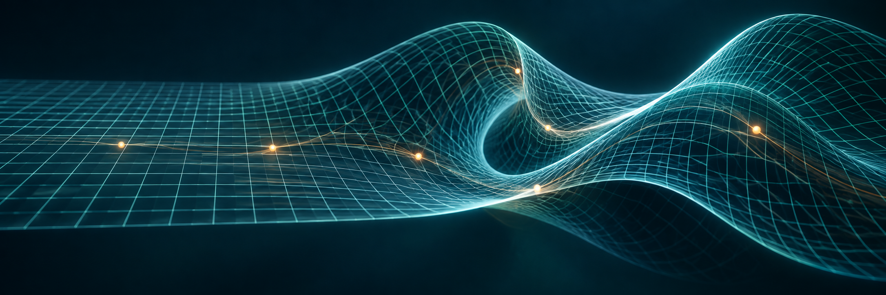

<!-- Generated from data/catalog.json by scripts/build_readme.py. -->

# Awesome Warping Algorithms

*A curated atlas of spatial warping.*

**English** · [简体中文](README.zh-CN.md)

Warping maps pixels, features, and noise across space and time, providing a foundation for image alignment, 3D reconstruction, and controllable generation. This repository connects classical methods with recent advances, organizing papers and implementations into six research areas and their topics to help researchers navigate the field, compare approaches, and build on existing work.

<b>57</b> Papers &nbsp; · &nbsp; <b>37</b> Repositories &nbsp; · &nbsp; <b>6</b> Research areas &nbsp; · &nbsp; <b>16</b> Topics

---

## 🧭 Start here

| Your interest | Suggested reading |
| --- | --- |
| **Warping fundamentals** | [TPS](#c05) → [MLS](#c08) → [STN](#c13) → [Softmax Splatting](#c19) |
| **Motion and video alignment** | [PWC-Net](#c15) → [RAFT](#c20) → [GMFlow](#n01) → [SEA-RAFT](#n13) → [MEMFOF](#n20) |
| **Dynamic 3D deformation** | [D-NeRF](#c21) → [Nerfies](#c22) → [Deformable 3D Gaussians](#n11) → [4D-GS](#n12) |
| **Diffusion and motion control** | [∫-noise](#n16) → [Go-with-the-Flow](#n19) → [CameraNoise](#n24) · [GenWarp](#n15) → [SplatDiff](#n23) |

<b>Scope and publication dates</b>

The collection focuses on **spatial warping** in computer vision, graphics and medical imaging. It distinguishes transformation models, correspondence estimators, resampling operators and application pipelines. Time-series DTW and GPU execution warps are outside its scope.

Entries follow **research area → topic**, with papers listed newest year first within each topic. Each topic opens with a scope and paper-count block. Papers follow a consistent sequence: full paper title (venue and year), one row of resource badges followed by technique tags, and a contribution summary. Full publication histories, code provenance and limitations remain in the bilingual catalog and research guides. Horizontal rules separate methods; classical and recent work appear together without year navigation or year groups. Published work uses its representative publication year, and preprints use their preprint year; publication histories are retained. Entries combining foundational methods use the publication year of the linked representative paper. Undated foundations appear last within their topic. Entries from the same year retain catalog order. Coverage ends on 2026-10-24. Descriptions are grounded in papers and author resources; the collection does not claim a unified reproduction of all methods.

Each work has one primary topic, with related tags and reading links for other directions. Spatial reasoning, world models, interactive simulation and embodied agents are reserved for future work directly connected to warping.

[Definitions, mapping conventions and evidence policy →](docs/RESEARCH_GUIDE.md#scope)

## 🗂️ Topic navigation

6 research areas and 16 topics, including 4 reserved topics. Counts include primary entries only; related reading is not counted twice.

<table>
<thead>
<tr><th align="left">Research area</th><th align="left">Topic</th><th align="left">Primary entries / status</th></tr>
</thead>
<tbody>
<tr>
<td rowspan="2" valign="middle"><a href="#area-foundations">1. Warping Foundations &amp; Operators</a></td>
<td><a href="#topic-geometry-editing">1.1 Geometric Transformations &amp; Deformation Editing</a></td>
<td>8</td>
</tr>
<tr>
<td><a href="#topic-sampling-splatting">1.2 Differentiable Sampling &amp; Splatting</a></td>
<td>3</td>
</tr>
<tr>
<td rowspan="3" valign="middle"><a href="#area-alignment">2. Correspondence &amp; Image Alignment</a></td>
<td><a href="#topic-optical-flow">2.1 Optical Flow &amp; Dense Correspondence</a></td>
<td>10</td>
</tr>
<tr>
<td><a href="#topic-image-alignment">2.2 Image Registration, Stitching &amp; Stabilization</a></td>
<td>5</td>
</tr>
<tr>
<td><a href="#topic-medical-registration">2.3 Medical Registration &amp; Diffeomorphic Deformation</a></td>
<td>8</td>
</tr>
<tr>
<td rowspan="2" valign="middle"><a href="#area-video-processing">3. Video Processing &amp; Human Deformation</a></td>
<td><a href="#topic-video-restoration">3.1 Video Interpolation &amp; Restoration</a></td>
<td>5</td>
</tr>
<tr>
<td><a href="#topic-human-deformation">3.2 Animation, Motion Transfer &amp; Virtual Try-On</a></td>
<td>4</td>
</tr>
<tr>
<td rowspan="2" valign="middle"><a href="#area-video-generation">4. Video Generation &amp; Motion Control</a></td>
<td><a href="#topic-noise-warping">4.1 Noise Warping &amp; Temporal Consistency</a></td>
<td>1</td>
</tr>
<tr>
<td><a href="#topic-controlled-generation">4.2 Camera-, Trajectory- &amp; Motion-Controlled Generation</a></td>
<td>3</td>
</tr>
<tr>
<td rowspan="4" valign="middle"><a href="#area-spatial-intelligence">5. Spatial Intelligence</a></td>
<td><a href="#topic-spatial-perception">5.1 Spatial Perception, Depth &amp; 3D Reconstruction</a></td>
<td>1</td>
</tr>
<tr>
<td><a href="#topic-novel-view-synthesis">5.2 Reprojection &amp; Novel View Synthesis</a></td>
<td>4</td>
</tr>
<tr>
<td><a href="#topic-dynamic-3d">5.3 Dynamic 3D &amp; 4D Scenes</a></td>
<td>5</td>
</tr>
<tr>
<td><a href="#topic-spatial-reasoning">5.4 Spatial Reasoning &amp; Scene Memory</a></td>
<td>Reserved</td>
</tr>
<tr>
<td rowspan="3" valign="middle"><a href="#area-world-models-agents">6. World Models &amp; Embodied Agents</a></td>
<td><a href="#topic-world-models">6.1 World Models &amp; Environment Prediction</a></td>
<td>Reserved</td>
</tr>
<tr>
<td><a href="#topic-interactive-simulation">6.2 Interactive Environments &amp; Simulation</a></td>
<td>Reserved</td>
</tr>
<tr>
<td><a href="#topic-embodied-agents">6.3 Embodied Agents, Planning &amp; Control</a></td>
<td>Reserved</td>
</tr>
</tbody>
</table>

## 1. Warping Foundations & Operators

### 1.1 Geometric Transformations & Deformation Editing

> **Scope** · Parametric transforms, TPS, FFD, MLS, ARAP, morphing, frequency-aware deformation and warp–unwarp
>
> **8 papers · Newest first**

---

#### WarpI2I: Image Warping for Image-to-Image Translation (ECCV 2026)

      &nbsp; [`T2`](#t2) [`T9`](#t9)

Uses a saliency-guided warp before encoding to allocate more spatial representation to salient regions, then unwarps the output to improve structural preservation in compact latent models.

---

#### LookingGlass: Generative Anamorphoses via Laplacian Pyramid Warping (CVPR 2025)

   &nbsp; [`T7`](#t7) [`T9`](#t9)

Uses Laplacian pyramids for frequency-aware image warping and view aggregation, enabling multiview generative anamorphoses.

---

#### As-Rigid-As-Possible Surface Modeling (SGP 2007)

     &nbsp; [`T3`](#t3)

Sorkine and Alexa preserve local shape through an as-rigid-as-possible energy, establishing a widely used approach to detail-preserving mesh editing.

---

#### Image deformation using moving least squares (SIGGRAPH / TOG 2006)

 &nbsp; [`T2`](#t2)

Schaefer and colleagues construct affine, similarity and rigid image deformations through locally weighted fitting, enabling interactive point and line controls.

---

#### Feature-Based Image Metamorphosis (SIGGRAPH 1992)

 &nbsp; [`T2`](#t2)

Uses corresponding feature-line pairs to control an inverse warp, then blends image colors to produce morphing effects.

---

#### Principal warps: thin-plate splines and the decomposition of deformations (TPAMI 1989)

 &nbsp; [`T2`](#t2)

Bookstein uses thin-plate splines for landmark-based deformation analysis, defining smooth nonrigid maps through bending energy. The underlying mathematics of TPS predates this paper.

---

#### Free-Form Deformation of Solid Geometric Models (SIGGRAPH 1986)

 &nbsp; [`T2`](#t2)

Sederberg and Parry deform geometric objects through a control lattice and Bernstein polynomials, establishing a foundation for volumetric free-form deformation.

---

#### Rigid / Similarity / Affine / Homography (Foundational models)

 &nbsp; [`T1`](#t1)

Global rigid, similarity, affine and projective maps provide compact coordinate transformations. A homography models a plane or a change of view under pure rotation about a fixed optical center.

---

Related reading · 1 papers in other topics

- [EWA Volume Splatting](#c25) (2001)

[↑ Start of 1.1](#topic-geometry-editing) · [↑ Back to topic navigation](#topics)

---

### 1.2 Differentiable Sampling & Splatting

> **Scope** · Interpolation, resampling, differentiable spatial transforms, sampling kernels, adjoints and derivatives
>
> **3 papers · Newest first**

---

#### ImWIP: Open-source image warping toolbox with adjoints and derivatives (SoftwareX 2023)

     &nbsp; [`T7`](#t7)

Provides differentiable image-warp operators with exact discrete adjoints and derivatives for inverse-problem optimization.

---

#### Spatial Transformer Networks (NeurIPS 2015)

  &nbsp; [`T7`](#t7)

Jointly trains transformation prediction, grid generation and differentiable sampling, making spatial transformation a learnable neural-network module.

---

#### EWA Volume Splatting (IEEE Visualization 2001)

 &nbsp; [`T7`](#t7)

Uses elliptical weighted-average kernels for projected reconstruction and low-pass filtering, providing a classic reference for splat footprints and antialiasing.

---

Related reading · 2 papers in other topics

- [Warped Diffusion](#n17) (2024)
- [B-spline FFD Registration](#c07) (1999)

[↑ Start of 1.2](#topic-sampling-splatting) · [↑ Back to topic navigation](#topics)

---

## 2. Correspondence & Image Alignment

### 2.1 Optical Flow & Dense Correspondence

> **Scope** · Motion estimation, correlation volumes, global matching and multiframe correspondence
>
> **10 papers · Newest first**

---

#### MEMFOF: High-Resolution Training for Memory-Efficient Multi-Frame Optical Flow Estimation (ICCV 2025)

      &nbsp; [`T4`](#t4)

Combines reduced correlation representations, multiframe estimation and high-resolution training to improve memory efficiency for native FullHD optical flow.

---

#### SEA-RAFT: Simple, Efficient, Accurate RAFT for Optical Flow (ECCV 2024)

     &nbsp; [`T4`](#t4)

Improves RAFT's efficiency and accuracy through initial-flow regression, a mixture-of-Laplace loss and rigid-motion pretraining.

---

#### Unifying Flow, Stereo and Depth Estimation (TPAMI 2023)

      &nbsp; [`T4`](#t4) [`T6`](#t6)

Unifies optical flow, stereo disparity and depth from posed views as dense correspondence-matching problems.

---

#### GMFlow: Learning Optical Flow via Global Matching (CVPR 2022)

     &nbsp; [`T4`](#t4)

Uses Transformer-enhanced cross-image features and global matching to estimate flow with less reliance on long sequences of iterative refinement.

---

#### FlowFormer: A Transformer Architecture for Optical Flow (ECCV 2022)

     &nbsp; [`T4`](#t4)

Encodes a 4D cost volume with Transformers and recurrently decodes motion updates.

---

#### RAFT: Recurrent All-Pairs Field Transforms for Optical Flow (ECCV 2020)

     &nbsp; [`T4`](#t4)

Builds all-pairs correlation volumes and updates a dense flow field recurrently, providing an influential baseline for correspondence estimation.

---

#### PWC-Net: CNNs for Optical Flow Using Pyramid, Warping, and Cost Volume (CVPR 2018)

    &nbsp; [`T4`](#t4)

Combines feature pyramids, feature warping and cost volumes to learn residual motion from coarse to fine.

---

#### Lucas-Kanade 20 Years On: A Unifying Framework (IJCV 2004)

 &nbsp; [`T1`](#t1) [`T4`](#t4)

Optimizes warp parameters using image residuals. The inverse compositional formulation reuses parts of the computation and remains a foundation of direct image alignment.

---

#### High Accuracy Optical Flow Estimation Based on a Theory for Warping (ECCV 2004)

 &nbsp; [`T4`](#t4)

Combines brightness and gradient constancy with edge-preserving regularization, and gives a theoretical interpretation of coarse-to-fine warping in the numerical solver.

---

#### Determining optical flow (Artificial Intelligence 1981)

90024-2) &nbsp; [`T4`](#t4)

Combines brightness constancy with a global smoothness regularizer, establishing a classical variational formulation of dense optical flow.

[↑ Start of 2.1](#topic-optical-flow) · [↑ Back to topic navigation](#topics)

---

### 2.2 Image Registration, Stitching & Stabilization

> **Scope** · Image alignment, panoramic stitching, parallax handling and temporal stabilization
>
> **5 papers · Newest first**

---

#### DMAligner: Enhancing Image Alignment via Diffusion Model Based View Synthesis (CVPR 2026)

     &nbsp; [`T9`](#t9)

Recasts image alignment as diffusion-based view synthesis, using dynamics-aware training to address occlusion and illumination variation.

---

#### Eliminating Warping Shakes for Unsupervised Online Video Stitching (ECCV 2024)

     &nbsp; [`T2`](#t2) [`T3`](#t3)

Unifies video stitching and stabilization in an unsupervised online framework, constraining spatial alignment and temporal stability to suppress warping shake.

---

#### Parallax-Tolerant Unsupervised Deep Image Stitching (ICCV 2023)

     &nbsp; [`T1`](#t1) [`T2`](#t2) [`T3`](#t3)

Combines global homography with local TPS, jointly considering overlap alignment, non-overlap shape preservation and seam composition.

---

#### As-Projective-As-Possible Image Stitching with Moving DLT (CVPR 2013)

 &nbsp; [`T3`](#t3)

Zaragoza and colleagues allow local departures from a global projective map through Moving DLT, accommodating parallax and nonplanarity in image stitching.

---

#### Content-Preserving Warps for 3D Video Stabilization (SIGGRAPH / TOG 2009)

  &nbsp; [`T3`](#t3)

Combines reconstructed 3D camera motion with content-preserving mesh warps to stabilize video while balancing alignment and salient-region shape.

---

Related reading · 4 papers in other topics

- [Lucas–Kanade / Inverse Compositional](#c02) (2004)
- [B-spline FFD Registration](#c07) (1999)
- [Thin-Plate Spline (TPS) / Principal Warps](#c05) (1989)
- [Rigid / Similarity / Affine / Homography](#c01) (Foundational models (undated))

[↑ Start of 2.2](#topic-image-alignment) · [↑ Back to topic navigation](#topics)

---

### 2.3 Medical Registration & Diffeomorphic Deformation

> **Scope** · Cross-modal registration, diffeomorphisms, topology preservation and inverse consistency
>
> **8 papers · Newest first**

---

#### uniGradICON: A Foundation Model for Medical Image Registration (MICCAI 2024)

    &nbsp; [`T5`](#t5)

Moves learned registration toward a reusable model across datasets, anatomical regions and new tasks, including zero-shot use and initialization for adaptation.

---

#### TransMorph: Transformer for unsupervised medical image registration (Medical Image Analysis 2022)

    &nbsp; [`T5`](#t5)

Uses a hybrid Transformer–ConvNet architecture to model long-range relationships in volumetric medical registration.

---

#### SynthMorph: learning contrast-invariant registration without acquired images (IEEE TMI 2022)

      &nbsp; [`T5`](#t5)

Trains with synthetic label maps and diverse image appearances to improve deformable registration across MRI contrasts.

---

#### VoxelMorph: A Learning Framework for Deformable Medical Image Registration (IEEE TMI 2019)

     &nbsp; [`T5`](#t5)

Amortizes pairwise optimization into a network that predicts deformation fields, trained with differentiable warping and image-similarity objectives.

---

#### Diffeomorphic demons: Efficient non-parametric image registration (NeuroImage 2009)

 &nbsp; [`T5`](#t5)

Introduces diffeomorphic updates within the Demons framework, combining efficient nonparametric registration with smooth, invertible deformation models.

---

#### Symmetric Diffeomorphic Image Registration with Cross-Correlation: Evaluating Automated Labeling of Elderly and Neurodegenerative Brain (Medical Image Analysis 2008)

    &nbsp; [`T5`](#t5)

Uses symmetric diffeomorphic registration with cross-correlation for anatomical alignment; SyN is a representative method in ANTs.

---

#### Computing Large Deformation Metric Mappings via Geodesic Flows of Diffeomorphisms (IJCV 2005)

  &nbsp; [`T5`](#t5)

Beg and colleagues construct large diffeomorphic deformations through smooth velocity fields and geodesic flows, forming a foundation of computational anatomy.

---

#### Nonrigid registration using free-form deformations: application to breast MR images (IEEE TMI 1999)

 &nbsp; [`T2`](#t2) [`T5`](#t5)

Rueckert and colleagues combine global affine alignment with local B-spline free-form deformation for nonrigid breast MR registration.

[↑ Start of 2.3](#topic-medical-registration) · [↑ Back to topic navigation](#topics)

---

## 3. Video Processing & Human Deformation

### 3.1 Video Interpolation & Restoration

> **Scope** · Interpolation, super-resolution, denoising, inpainting, cross-frame feature alignment and video inverse problems
>
> **5 papers · Newest first**

---

#### Warped Diffusion: Solving Video Inverse Problems with Image Diffusion Models (NeurIPS 2024)

   &nbsp; [`T9`](#t9)

Uses continuous function spaces and transformation equivariance for video inverse problems, improving temporal consistency with test-time self-equivariance guidance.

---

#### FILM: Frame Interpolation for Large Motion (ECCV 2022)

      &nbsp; [`T4`](#t4) [`T8`](#t8)

Shares feature extraction and motion estimation across scales to improve large-motion frame interpolation using training from image frames alone.

---

#### BasicVSR++: Improving Video Super-Resolution with Enhanced Propagation and Alignment (CVPR 2022)

     &nbsp; [`T4`](#t4) [`T8`](#t8)

Combines second-order propagation with flow-guided deformable alignment to integrate optical-flow priors and adaptive feature sampling for video restoration.

---

#### Softmax Splatting for Video Frame Interpolation (CVPR 2020)

     &nbsp; [`T7`](#t7)

Niklaus and Liu use softmax weighting to resolve many-to-one conflicts in a differentiable forward warp, supporting both image and feature splatting.

---

#### Deformable Convolutional Networks (ICCV 2017)

    &nbsp; [`T8`](#t8)

Learns offsets for convolutional sampling locations, allowing features to adapt to local geometric variation.

---

Related reading · 2 papers in other topics

- [RAFT](#c20) (2020)
- [PWC-Net](#c15) (2018)

[↑ Start of 3.1](#topic-video-restoration) · [↑ Back to topic navigation](#topics)

---

### 3.2 Animation, Motion Transfer & Virtual Try-On

> **Scope** · Animation, appearance preservation, pose transfer and garment alignment
>
> **4 papers · Newest first**

---

#### StableVITON: Learning Semantic Correspondence with Latent Diffusion Model for Virtual Try-On (CVPR 2024)

     &nbsp; [`T9`](#t9)

Learns semantic garment-to-person correspondence inside a latent diffusion model, using attention for implicit alignment and detail transfer.

---

#### Thin-Plate Spline Motion Model for Image Animation (CVPR 2022)

     &nbsp; [`T2`](#t2) [`T8`](#t8)

Extends local affine motion representations to multiple TPS transformations, using multiscale occlusion masks for feature warping in image animation.

---

#### First Order Motion Model for Image Animation (NeurIPS 2019)

      &nbsp; [`T8`](#t8) [`T9`](#t9)

Learns keypoints and local first-order affine motion to construct dense feature warps and occlusion maps for image animation.

---

#### Toward Characteristic-Preserving Image-based Virtual Try-On Network (ECCV 2018)

     &nbsp; [`T2`](#t2) [`T9`](#t9)

Learns a TPS with a geometric matching module to align an in-shop garment with a person, then learns a composition mask.

---

Related reading · 1 papers in other topics

- [Go-with-the-Flow](#n19) (2025)

[↑ Start of 3.2](#topic-human-deformation) · [↑ Back to topic navigation](#topics)

---

## 4. Video Generation & Motion Control

### 4.1 Noise Warping & Temporal Consistency

> **Scope** · Random-field transport, noise statistics, motion-correlated noise and temporal consistency
>
> **1 papers · Newest first**

---

#### How I Warped Your Noise: a Temporally-Correlated Noise Prior for Diffusion Models (ICLR 2024)

     &nbsp; [`T7`](#t7) [`T9`](#t9)

Interprets pixel noise as integrals over a continuous white-noise field and designs transport for Gaussian statistics while retaining motion-induced temporal correlation.

---

Related reading · 2 papers in other topics

- [CameraNoise](#n24) (2026)
- [Go-with-the-Flow](#n19) (2025)

[↑ Start of 4.1](#topic-noise-warping) · [↑ Back to topic navigation](#topics)

---

### 4.2 Camera-, Trajectory- & Motion-Controlled Generation

> **Scope** · Camera and object-motion control, geometric guidance and history-frame alignment
>
> **3 papers · Newest first**

---

#### CameraNoise: Enabling Faithful Camera Control in Video Diffusion through Geometry-Flow-Guided Noise Warping (ICML 2026)

      &nbsp; [`T6`](#t6) [`T9`](#t9)

Uses geometry-guided reprojection flow and noise warping to encode camera motion into temporally correlated noise, while preserving the Gaussian prior and trajectory control.

---

#### Warp-as-History: Generalizable Camera-Controlled Video Generation from One Training Video (arXiv 2026)

      &nbsp; [`T6`](#t6) [`T9`](#t9)

Turns camera-induced warps into pseudo-history aligned with target positions, selecting valid tokens to use a frozen model's visual-history pathway; also explores single-video LoRA adaptation.

---

#### Go-with-the-Flow: Motion-Controllable Video Diffusion Models Using Real-Time Warped Noise (CVPR 2025)

      &nbsp; [`T9`](#t9)

Efficiently constructs warped noise and adapts video diffusion models to use it as a motion prior for motion transfer and camera or object control.

---

Related reading · 3 papers in other topics

- [How I Warped Your Noise / ∫-noise](#n16) (2024)
- [RAFT](#c20) (2020)
- [Softmax Splatting](#c19) (2020)

[↑ Start of 4.2](#topic-controlled-generation) · [↑ Back to topic navigation](#topics)

---

## 5. Spatial Intelligence

### 5.1 Spatial Perception, Depth & 3D Reconstruction

> **Scope** · Depth, stereo, multiview geometry, camera pose and scene reconstruction
>
> **1 papers · Newest first**

---

#### Digging Into Self-Supervised Monocular Depth Estimation (ICCV 2019)

    &nbsp; [`T6`](#t6)

Uses depth, pose and differentiable reprojection for self-supervised view reconstruction, introducing minimum reprojection loss and automasking.

---

Related reading · 2 papers in other topics

- [UniMatch: Unifying Flow, Stereo and Depth Estimation](#n09) (2023)
- [Rigid / Similarity / Affine / Homography](#c01) (Foundational models (undated))

[↑ Start of 5.1](#topic-spatial-perception) · [↑ Back to topic navigation](#topics)

---

### 5.2 Reprojection & Novel View Synthesis

> **Scope** · DIBR, cross-view warping, visibility and disocclusion completion
>
> **4 papers · Newest first**

---

#### WAVE: Warp-Based View Guidance for Consistent Novel View Synthesis Using a Single Image (ICCV 2025)

    &nbsp; [`T6`](#t6) [`T9`](#t9)

Uses view warping to guide adaptive attention and noise reinitialization, improving single-image novel-view consistency without additional training.

---

#### High-Fidelity Novel View Synthesis via Splatting-Guided Diffusion (SIGGRAPH 2025)

   &nbsp; [`T6`](#t6) [`T7`](#t7) [`T9`](#t9)

Uses pixel splatting to constrain target views and combines aligned synthesis with a texture bridge to balance geometric consistency and texture fidelity.

---

#### GenWarp: Single Image to Novel Views with Semantic-Preserving Generative Warping (NeurIPS 2024)

      &nbsp; [`T6`](#t6) [`T9`](#t9)

Combines depth-induced coordinate information with cross-view and self-attention, learning which content to transfer and which missing regions to generate.

---

#### Depth-image-based rendering (DIBR), compression, and transmission for a new approach on 3D-TV (SPIE 2004)

 &nbsp; [`T6`](#t6)

Synthesizes virtual views from color and depth, providing a classic route to depth reprojection, visibility reasoning and hole handling. This paper did not originate the general idea of reprojection.

---

Related reading · 3 papers in other topics

- [D-NeRF](#c21) (2021)
- [Nerfies](#c22) (2021)
- [Monodepth2](#c16) (2019)

[↑ Start of 5.2](#topic-novel-view-synthesis) · [↑ Back to topic navigation](#topics)

---

### 5.3 Dynamic 3D & 4D Scenes

> **Scope** · Canonical deformation, dynamic NeRF, deformable Gaussians and spatiotemporal scene representations
>
> **5 papers · Newest first**

---

#### Deformable 3D Gaussians for High-Fidelity Monocular Dynamic Scene Reconstruction (CVPR 2024)

      &nbsp; [`T8`](#t8)

Learns a deformation field over canonical Gaussians, combining dynamic reconstruction with fast splatting-based rendering.

---

#### 4D Gaussian Splatting for Real-Time Dynamic Scene Rendering (CVPR 2024)

      &nbsp; [`T8`](#t8)

Combines spatiotemporal features with Gaussian deformation to improve training, storage and rendering efficiency for dynamic scenes.

---

#### D-NeRF: Neural Radiance Fields for Dynamic Scenes (CVPR 2021)

     &nbsp; [`T8`](#t8)

Learns time-conditioned deformation that maps dynamic-scene coordinates into a canonical radiance field.

---

#### Nerfies: Deformable Neural Radiance Fields (ICCV 2021)

      &nbsp; [`T8`](#t8)

Combines continuous 3D deformation, elastic regularization and coarse-to-fine optimization to reconstruct casually captured nonrigid scenes.

---

#### HyperNeRF: A Higher-Dimensional Representation for Topologically Varying Neural Radiance Fields (SIGGRAPH Asia / TOG 2021)

     &nbsp; [`T8`](#t8)

Lifts the representation into a higher-dimensional space and uses slices to model topology changes beyond ordinary continuous 3D warps.

[↑ Start of 5.3](#topic-dynamic-3d) · [↑ Back to topic navigation](#topics)

---

### 5.4 Spatial Reasoning & Scene Memory

> **Scope** · Spatial relationships, cross-view understanding, persistent maps and spatial memory
>
> **Reserved · No papers collected yet**

---

**Reserved:** No papers collected yet. Future entries should directly connect to spatial correspondence, reprojection, deformation, noise transport or spatiotemporal alignment.

[↑ Start of 5.4](#topic-spatial-reasoning) · [↑ Back to topic navigation](#topics)

---

## 6. World Models & Embodied Agents

### 6.1 World Models & Environment Prediction

> **Scope** · State representations, dynamics prediction, action-conditioned prediction and future rollouts
>
> **Reserved · No papers collected yet**

---

**Reserved:** No papers collected yet. Future entries should directly connect to spatial correspondence, reprojection, deformation, noise transport or spatiotemporal alignment.

[↑ Start of 6.1](#topic-world-models) · [↑ Back to topic navigation](#topics)

---

### 6.2 Interactive Environments & Simulation

> **Scope** · Interactive world generation, scene persistence, training and evaluation environments, and synthetic data
>
> **Reserved · No papers collected yet**

---

**Reserved:** No papers collected yet. Future entries should directly connect to spatial correspondence, reprojection, deformation, noise transport or spatiotemporal alignment.

[↑ Start of 6.2](#topic-interactive-simulation) · [↑ Back to topic navigation](#topics)

---

### 6.3 Embodied Agents, Planning & Control

> **Scope** · Visual navigation, robotic manipulation, active perception, spatial-memory-guided planning and perception–action loops
>
> **Reserved · No papers collected yet**

---

**Reserved:** No papers collected yet. Future entries should directly connect to spatial correspondence, reprojection, deformation, noise transport or spatiotemporal alignment.

[↑ Start of 6.3](#topic-embodied-agents) · [↑ Back to topic navigation](#topics)

---

## 🧩 Technique cross-index

Methods can belong to multiple families. Follow a method name to its primary entry; `T1–T9` tags link back to this map. Works are listed newest year first.

<b>Browse all 9 technique families</b>

| Technique family | Core representation | Works |
| --- | --- | --- |
| **T1 · Parametric geometry** | Rigid / similarity / affine / homography | [UDIS++: Parallax-Tolerant Unsupervised Deep Image Stitching](#n08) · [Lucas–Kanade / Inverse Compositional](#c02) · [Rigid / Similarity / Affine / Homography](#c01) |
| **T2 · Control points and splines** | TPS / RBF / FFD / B-splines / MLS | [WarpI2I](#n26) · [StabStitch](#n28) · [UDIS++: Parallax-Tolerant Unsupervised Deep Image Stitching](#n08) · [Thin-Plate Spline Motion Model for Image Animation](#n03) · [CP-VTON](#c24) · [Moving Least Squares (MLS)](#c08) · [B-spline FFD Registration](#c07) · [Beier–Neely Feature-Based Morphing](#c06) · [Thin-Plate Spline (TPS) / Principal Warps](#c05) · [Free-Form Deformation (FFD)](#c04) |
| **T3 · Meshes and local shape preservation** | Piecewise maps / ARAP / local projective models | [StabStitch](#n28) · [UDIS++: Parallax-Tolerant Unsupervised Deep Image Stitching](#n08) · [As-Projective-As-Possible (APAP) / Moving DLT](#c12) · [Content-Preserving Warps for 3D Video Stabilization](#c29) · [As-Rigid-As-Possible (ARAP) Surface Modeling](#c09) |
| **T4 · Dense correspondence and optical flow** | Dense flow / correlation volumes / global matching | [MEMFOF](#n20) · [SEA-RAFT](#n13) · [UniMatch: Unifying Flow, Stereo and Depth Estimation](#n09) · [GMFlow](#n01) · [FlowFormer](#n02) · [FILM: Frame Interpolation for Large Motion](#n04) · [BasicVSR++](#n07) · [RAFT](#c20) · [PWC-Net](#c15) · [Lucas–Kanade / Inverse Compositional](#c02) · [Brox et al. Variational Optical Flow](#c27) · [Horn–Schunck](#c03) |
| **T5 · Invertible deformation and registration** | Velocity fields / diffeomorphisms / inverse consistency | [uniGradICON](#n14) · [TransMorph](#n05) · [SynthMorph](#n06) · [VoxelMorph](#c18) · [Diffeomorphic Demons](#c11) · [SyN: Symmetric Diffeomorphic Registration](#c10) · [LDDMM / Geodesic Flows of Diffeomorphisms](#c26) · [B-spline FFD Registration](#c07) |
| **T6 · Depth and 3D reprojection** | Depth / camera pose / projection / visibility | [CameraNoise](#n24) · [Warp-as-History](#n27) · [WAVE: Warp-Based View Guidance](#n22) · [SplatDiff: High-Fidelity Novel View Synthesis via Splatting-Guided Diffusion](#n23) · [GenWarp](#n15) · [UniMatch: Unifying Flow, Stereo and Depth Estimation](#n09) · [Monodepth2](#c16) · [Depth-Image-Based Rendering (DIBR)](#c28) |
| **T7 · Differentiable sampling and splatting** | Interpolation / footprints / aggregation / adjoints | [LookingGlass / Laplacian Pyramid Warping (LPW)](#n21) · [SplatDiff: High-Fidelity Novel View Synthesis via Splatting-Guided Diffusion](#n23) · [How I Warped Your Noise / ∫-noise](#n16) · [ImWIP](#n10) · [Softmax Splatting](#c19) · [Spatial Transformer Networks (STN)](#c13) · [EWA Volume Splatting](#c25) |
| **T8 · Learned feature and 3D deformation** | Offsets / local affine motion / canonical fields | [Deformable 3D Gaussians](#n11) · [4D Gaussian Splatting for Real-Time Dynamic Scene Rendering](#n12) · [Thin-Plate Spline Motion Model for Image Animation](#n03) · [FILM: Frame Interpolation for Large Motion](#n04) · [BasicVSR++](#n07) · [D-NeRF](#c21) · [Nerfies](#c22) · [HyperNeRF](#c23) · [First Order Motion Model (FOMM)](#c17) · [Deformable ConvNets (DCN)](#c14) |
| **T9 · Generative, frequency and stochastic warping** | Geometry–generation fusion / noise transport / frequency handling | [CameraNoise](#n24) · [DMAligner](#n25) · [WarpI2I](#n26) · [Warp-as-History](#n27) · [Go-with-the-Flow](#n19) · [LookingGlass / Laplacian Pyramid Warping (LPW)](#n21) · [WAVE: Warp-Based View Guidance](#n22) · [SplatDiff: High-Fidelity Novel View Synthesis via Splatting-Guided Diffusion](#n23) · [GenWarp](#n15) · [How I Warped Your Noise / ∫-noise](#n16) · [Warped Diffusion](#n17) · [StableVITON](#n18) · [First Order Motion Model (FOMM)](#c17) · [CP-VTON](#c24) |

## 🛠️ Evaluation and implementation resources

| Resource | Entry point |
| --- | --- |
| Metrics and comparison principles | [Evaluation guidance](docs/RESEARCH_GUIDE.md#evaluation) |
| Image transforms, differentiable sampling and deformation tools | [Tools and starting points](docs/RESEARCH_GUIDE.md#practice) |
| Datasets and benchmarks | To be added; contributions should specify the task, data version, metrics and evaluation protocol |

## 📖 Reading guide

| Explore further | Resource |
| --- | --- |
| Definitions and mapping conventions | [Forward / backward warping and the three layers](docs/RESEARCH_GUIDE.md#scope) |
| Research trends and open problems | [What changed, and what remains difficult](docs/RESEARCH_GUIDE.md#trends) |
| Noise-warping statistics | [Why ordinary interpolation changes Gaussian noise](docs/RESEARCH_GUIDE.md#noise) |
| Implementation and method selection | [Tools and practical starting points](docs/RESEARCH_GUIDE.md#practice) |
| Extended research notes | [Detailed Chinese guide](docs/RESEARCH_GUIDE.zh-CN.md) |

## 🤝 Contributing

Suggestions, corrections and verified links are welcome through [Issues](https://github.com/gulucaptain/Awesome-Warping-Algorithm/issues) and [Pull Requests](https://github.com/gulucaptain/Awesome-Warping-Algorithm/pulls).

Please include the **paper title, publication year/status, Paper, Project, GitHub, technique family, primary topic and related topic tags**. Leave unavailable links empty, and distinguish author implementations, third-party reimplementations and shared frameworks.

Edit [the bilingual catalog](data/catalog.json) and run `python3 scripts/build_readme.py` to update both READMEs. Counts and indexes use the same data; check consistency with `python3 scripts/build_readme.py --check`. Set each work's unique home with `primary_topic`; `topics` contains that home and related directions. When adding papers to a reserved topic, set its `reserved` flag to `false`.

Design references and acknowledgments

The text-free banner was generated with GPT-Image. The layout uses GitHub-native Markdown. Navigation and resource organization were informed by these collections and templates; their paper descriptions and images were not copied:

- [Awesome Diffusion Models in Medical Imaging](https://github.com/amirhossein-kz/Awesome-Diffusion-Models-in-Medical-Imaging)
- [Awesome Diffusion Models](https://github.com/diff-usion/Awesome-Diffusion-Models)
- [Awesome Diffusion Categorized](https://github.com/wangkai930418/awesome-diffusion-categorized)
- [Awesome list guidelines](https://github.com/sindresorhus/awesome/blob/main/awesome.md)
- [Best README Template](https://github.com/othneildrew/Best-README-Template)
- [Shields.io](https://shields.io/) and [Simple Icons](https://simpleicons.org/): branded resource badges
- [Hugging Face brand assets](https://huggingface.co/brand): brand reference

Brand marks identify linked services and do not imply endorsement.

**[↑ Back to top](#top)**

Map coordinates. Preserve structure. Explore motion.

